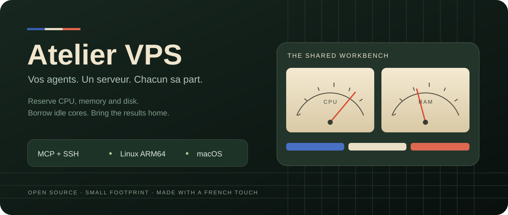

<p align="center"></p>

<p align="center">
<a href="https://github.com/guillaume34110/atelier-vps/actions/workflows/ci.yml"></a>
<a href="LICENSE"></a>


</p>

<p align="center"><strong>A shared Linux workbench for your local coding agents.</strong><br>
Reserve a slice of CPU, RAM and disk. Learn memory peaks. Bring verified results home.</p>

<p align="center"><a href="docs/README.fr.md">Français</a> · <a href="docs/deployment.md">Server setup</a> · <a href="docs/integration.md">Agent integration</a> · <a href="docs/architecture.md">Resource sharing</a> · <a href="docs/widget.md">Mac widget</a></p>

Atelier VPS moves compatible builds, tests and file processing off your laptop.
Several agents can share connected VPS servers, with atomic resource
reservations and bounded jobs. Node, Python, Java, Chromium and native build
utilities share one immutable toolchain. A small native Mac widget shows real
analog CPU/RAM gauges, connected agents, transfers and timestamped activity.
Its Global view adds your connected pools, then shows each server and team.
Add servers with the widget or agent; join a team with a private one-use link.
See [multiple servers and invitations](docs/fleet.md).
The optional [remote programs](docs/agents.md) run official desktop applications
on the VPS, with account sign-in and private screen sharing from the widget.

No public worker port is required. The local client and MCP server use a
restricted SSH gateway. Your credentials stay in your own SSH configuration.

## Get started

First deploy your **own VPS** using the [server guide](docs/deployment.md), or ask
its operator for an invitation or a restricted SSH alias. The maintainer's infrastructure is not
a hosted service for public use.

```sh
git clone https://github.com/guillaume34110/atelier-vps.git
cd atelier-vps
python3 scripts/install.py --host dev-vps
atelier-vps status
```

The macOS/Linux client needs Python 3.10+ and OpenSSH. Install [uv](https://docs.astral.sh/uv/)
for the pinned MCP dependency. With a working Codex CLI, the installer registers
`atelier-vps`, sets its tool timeout and installs the VPS-first routing skill.
Restart the agent host to discover the tools. Keep `~/.local/bin` on PATH.

```sh
atelier-vps run --source ./my-project --agent "Tests · API" \
  --cpus 1 --ram-gib auto --disk-gib 2 --timeout 900 -- npm test
```

Sources are filtered and streamed without a second local archive. Local
dependencies, Git history, common secret files and generated outputs are
excluded. Recreate dependencies from lockfiles for the selected Linux architecture.
Portable work can use either architecture; pin `--arch aarch64` or `--arch x86_64`
when its dependencies or outputs require one.

RAM `auto` learns this workload's observed peak and adds headroom; new workloads
start conservatively. Explicit GiB remain available. Admission never silently
reduces a reservation to fit. See [measured RAM and private developer pools](docs/team.md)
for both modes, separate quotas and the authenticated administrator MCP tools.

`vps_run` waits for its result. To resume waiting for an already running job,
use `vps_wait` or `atelier-vps wait connection:JOB_ID` and let the server return
its final state without repeated agent polling. [Integration details](docs/integration.md).

For recurring work, store a versioned source snapshot on one server and reuse it
without uploading the same project each time:

```sh
atelier-vps project-prepare --source ./my-project --id my-project --disk-gib 1
# Use the returned connection:project:revision reference.
atelier-vps project-run --source ./my-project --agent "Tests · API" --disk-gib 1 PROJECT_REF -- npm test
```

Each task receives its own verified copy, so parallel tasks cannot overwrite the
stored version. Prepare a new version after local edits. Sources remain on the
developer's VPS and count against its quota; they are never automatically deleted.

Fetch into explicitly bounded temporary storage, then preserve useful files
before releasing the completed remote job:

```sh
mkdir -p /your/bounded/task-workspace
TASK_WORKSPACE=/your/bounded/task-workspace atelier-vps fetch JOB_ID \
  stdout.log receipt.json work/result.json
# Inspect and preserve the verified files first.
atelier-vps release JOB_ID --confirmed
```

Use any stricter local storage guard. The MCP integration detects the canonical
`workspace-budget.py` helper automatically. [Transfer details](docs/integration.md).
The legacy `usevps` launcher can keep pointing to the same client.

## Share the cake

| Resource | Behavior |
| --- | --- |
| CPU | Reserve whole cores; idle cores are lent and reassigned as jobs join or leave. |
| RAM | Learn a measured peak plus headroom, or reserve explicit GiB; admission protects real host capacity. |
| Disk | Reserve the complete peak: sources, dependencies, caches, logs and results. |
| Jobs | Up to four per developer worker, subject to actual CPU, RAM and disk capacity. |
| Neighbors | Low CPU priority, a host RAM floor and container limits protect other projects. |
| Maintenance | An exclusive deployment lock waits for active jobs to finish. |

The reference pool has 4 ARM64 vCPU, a 5 GiB container ceiling, a 1 GiB host RAM
floor and a dedicated 30 GiB volume. Shared tools occupy about 2 GiB; the rest
has a hard ext4 workspace quota, with a 512 MiB physical margin. Always read
**live status**: retained results and caches consume capacity. The original
system disk is never used for overflow.

Container memory and workspace quota are hard limits. Per-job RAM/disk guards
are sampled checks, not kernel isolation between hostile jobs. An unexpected
supervisor death blocks admission until a controlled restart. Finished results
remain retrievable when resources are exhausted.

## Compact toolchain

| Workload | Included |
| --- | --- |
| JavaScript | Node 22, npm, pnpm |
| Python | Python 3.12, venv, pip, uv |
| Java / Android support | JDK 17, Gradle, ADB, fastboot |
| Browser checks | Chromium, Playwright |
| Native / media / data | GCC/G++, Make, CMake, Ninja, ffmpeg, SQLite, jq, Git, rsync, ZIP, RTK |

Exact versions and checksums are in [toolchain-lock.json](ops/toolchain-lock.json).
Keep macOS APIs, Metal/MLX, GPU tasks, Docker daemon work, Android emulators and
incompatible SDK/NDK binaries on a compatible machine.

The base tools stay installed; they do not reserve idle RAM. Reproducible
dependency caches are reused by project and lockfile digest. Using that scope
refreshes its retention for 30 days. An hourly idle pass removes only expired,
marked cache scopes, with the same exclusive lock that protects deployments.
Running jobs, immutable tools, sources, results and untracked legacy caches are
never swept. A cold scope downloads its locked dependencies again; allow that
peak in the disk reservation.

## Designed to be understood

Read the [architecture](docs/architecture.md), [security model](SECURITY.md),
[deployment guide](docs/deployment.md) and [contribution workflow](CONTRIBUTING.md).
The [examples](examples) exercise a browser with a real API, Python/native code
and Java/Gradle. CI also tests simultaneous jobs, memory stops, cleanup, timeouts
and verified transfers.

The Mac widget uses SwiftUI/AppKit, keeps one SSH request in flight and stops
polling while hidden. It shows unavailable readings honestly. No Electron
runtime or local web server is needed. [Build and install it](docs/widget.md).

Made by Guillaume Gaillard. [MIT licensed](LICENSE).
